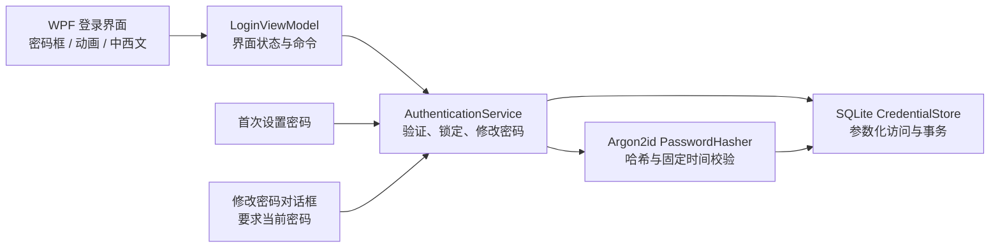
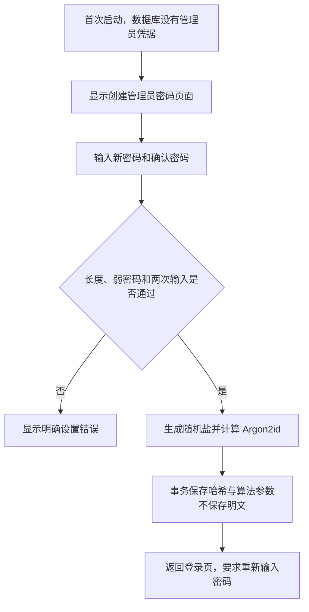
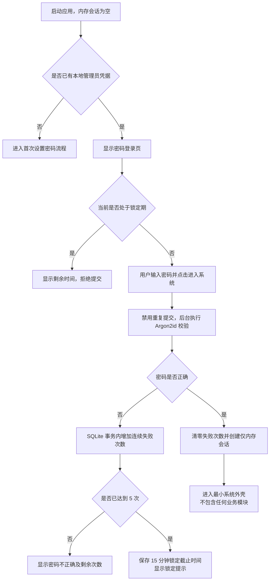
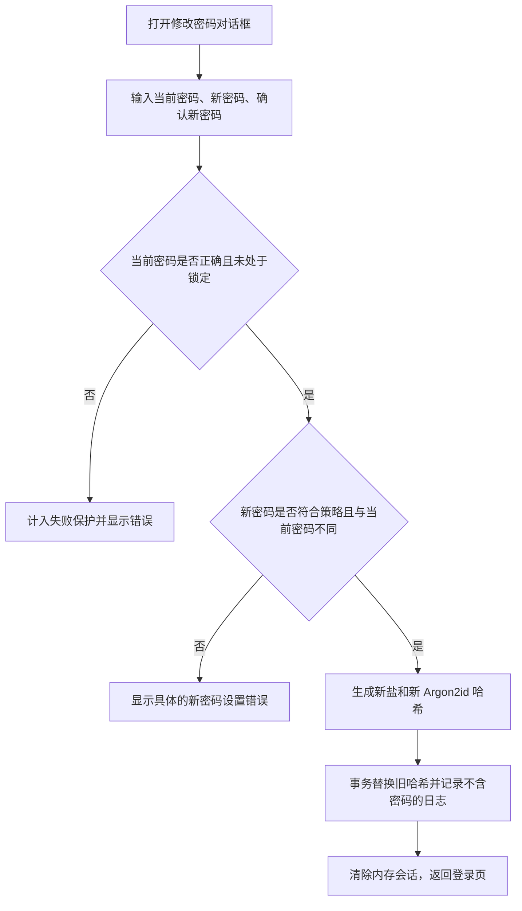

# TPOS^ — 第一阶段：简化密码登录系统设计方案

> 更新日期：2026-11-03
> 当前状态：第二阶段代码已进入 Windows 编译与测试验收
> 适用范围：本地密码登录、首次设置密码、管理员修改密码、失败锁定及登录界面

## 1. 本次方案调整

本方案取代此前的邮箱双重验证设计。以下内容已从本阶段全部移除：

- 电子邮箱输入和邮箱登录。
- 邮箱验证码、双重身份验证、忘记密码邮件。
- 云端认证服务器、在线设备授权、邮件 API 和外部邮件服务。
- 记住设备、在线刷新令牌及跨设备同步。

新方案只保留一个**本地管理员密码**。应用不需要互联网，不向外部服务发送账号、密码或日志。

为避免把简单需求复杂化，本阶段不设计多用户和角色管理界面。`Administrator` 仅表示本机唯一的管理员凭据，不扩展为 RBAC 系统。

---

## 2. 当前项目与环境检查

| 检查项 | 实际结果 |
|---|---|
| 原仓库内容 | `README.md` 与 CHINA MARKET 的 `index.html`，尚无 C# / WPF 项目 |
| 原文件保护 | 两个原有文件均无修改；不会删除或覆盖原商城网页 |
| 当前新增内容 | 仅 `docs/tpos/` 下的本阶段文档与静态预览 |
| .NET SDK | 当前环境找不到 `dotnet` 命令，暂时不能编译或测试 WPF |
| 当前运行环境 | Linux 沙箱，不能真实运行 Windows WPF 窗口 |

Windows 11、.NET 10 与 WPF 的技术方向可行，但必须在 Windows 11 开发机安装 .NET 10 SDK 后，才能实测第三方 Argon2id、SQLite、MVVM 和界面库的兼容性。不能将“设计上兼容”写成“已经测试通过”。

---

## 3. 推荐的本地架构



### 3.1 模块职责

| 模块 | 职责 |
|---|---|
| WPF Views | 显示界面、动画和错误，不包含密码判断逻辑 |
| ViewModels | 管理加载、错误、锁定倒计时、语言切换；不直接操作数据库 |
| AuthenticationService | 首次设置、验证、5 次失败锁定、修改密码和内存会话 |
| PasswordHasher | Argon2id 哈希与校验，保存算法参数以便未来升级 |
| SQLite | 保存哈希记录、失败次数、锁定截止时间和最小认证日志 |

### 3.2 本地数据存放

- 数据库建议放在 `%ProgramData%\Tpos\Security\auth.db`，由安装程序设置合适的 Windows 访问权限。
- 数据库不放在安装目录、源码目录或 Git 仓库中。
- 只保存密码哈希及其参数，不保存明文密码。
- 应用不保存“已登录”标记。每次启动都创建空的内存会话，必须重新输入密码。

### 3.3 建议的密码策略（待批准）

| 项目 | 建议 |
|---|---|
| 初始密码 | 第一次启动时由负责人创建，无默认密码 |
| 长度 | 12–128 个字符，允许粘贴、空格及中西文 |
| 弱密码 | 拒绝常见弱密码和纯连续字符；不使用复杂但难记的无意义组合规则 |
| 哈希 | Argon2id，16 字节随机盐，32 字节输出 |
| 起始参数 | 64 MiB 内存、3 次迭代、并行度 1；在目标电脑上实测后调整 |
| 失败锁定 | 连续失败 5 次后锁定 15 分钟；锁定期间即使密码正确也不接受 |
| 重启处理 | 失败次数和锁定截止时间持久化，重启不能清零 |
| 修改密码 | 必须输入当前密码，再输入两次新密码；修改后清除当前会话并要求重新登录 |

---

## 4. 登录页视觉与动态设计

### 4.1 页面布局

- 默认窗口约 **1100 × 700 dp**，最小约 **860 × 580 dp**。
- 中央偏左放置品牌区，右侧放置宽度约 380–420 dp 的登录卡片；窄窗口改为上下居中布局。
- 品牌包含一个简洁的圆角方形 `T` 字 Logo、TPOS^ 名称及一句简短说明。
- 登录卡片只包含：标题、密码框、显示/隐藏按钮、错误区域、进入系统按钮、修改密码入口和中西文切换。
- 不显示邮箱框、验证码框、记住设备或网络状态。

### 4.2 视觉规范

| 项目 | 设计值 |
|---|---|
| 字体 | `Segoe UI Variable`，中文回退 `Microsoft YaHei UI` |
| 背景 | 深海军蓝到墨青的柔和渐变，叠加两个低对比度径向光斑 |
| 品牌强调 | 哑光金 `#D3B27A`，只用于 Logo 和少量细节 |
| 登录卡片 | 半透明深色卡片、细边框、轻阴影、16 dp 圆角 |
| 输入框 | 48 dp 高、10 dp 圆角，聚焦时边框和光晕平滑变化 |
| 主按钮 | 金色系或高对比浅色按钮、深色文字，悬停时轻微上浮 |
| 错误 | 浅红图标与明确文字，不仅靠红色表达 |
| 间距 | 8 dp 基础网格，统一使用 8 / 16 / 24 / 32 dp |

### 4.3 动画方案与性能控制

| 动画 | 建议参数 | 性能方式 |
|---|---|---|
| 背景渐变光效 | 18–24 秒缓慢循环，位移很小 | 只动画变换和透明度，不每帧重绘大尺寸模糊图 |
| Logo 浮动 | 4 秒一轮，上下约 4 dp，缓入缓出 | 动画 `TranslateTransform`，不改变布局 |
| 卡片进入 | 首次显示约 350 毫秒，淡入并上移 12 dp | 只执行一次，不循环 |
| 按钮悬停 | 120–160 毫秒，颜色过渡并上浮 1–2 dp | 使用 RenderTransform 和画刷动画 |
| 输入框聚焦 | 150 毫秒边框/光晕过渡 | 不放大整个布局，不引发布局抖动 |

额外规则：

- 密码哈希在后台线程执行，避免 Argon2id 计算时卡住动画和界面。
- 窗口最小化、页面不可见时暂停装饰动画。
- 尊重 Windows“显示动画”设置；用户关闭动画时使用静态背景并取消浮动。
- 低性能模式可减少光斑和阴影，不影响验证功能。
- 动画不是安全状态的唯一提示，加载和错误仍有明确文字。

### 4.4 静态预览

文件：[`prototypes/login-preview.html`](prototypes/login-preview.html)

预览支持动态背景、Logo 浮动、卡片淡入、按钮悬停、输入聚焦、密码显隐、中西文切换和错误/锁定状态展示。

**预览不连接数据库，不验证密码，也没有预设密码。点击按钮只会提示这是视觉原型，不会显示登录成功。**

---

## 5. 完整流程设计

### 5.1 第一次启动



首次设置后不会自动进入系统，以确认用户确实记住了新密码。

### 5.2 日常完全离线登录



### 5.3 管理员修改密码



修改密码不需要邮件或互联网。当前密码验证是修改权限的安全边界，不能提供跳过当前密码的隐藏入口。

### 5.4 关闭与退出

- 关闭窗口、退出应用或主动注销时，立即丢弃内存会话并清空密码框。
- 再次启动始终要求密码；不提供自动登录或“记住密码”。
- 业务外壳只用于证明认证结果，提供注销按钮，不开发任何收银功能。

---

## 6. 安全边界与现实限制

1. **Argon2id 不是万能保护。** 如果用户设置弱密码，仍可能被离线猜测，因此首次设置和修改时必须检查弱密码。
2. **重启不能解除锁定。** 失败次数与锁定截止时间写入 SQLite，并使用事务更新，避免并发重复提交绕过计数。
3. **离线环境没有完全可信的时间。** 本机管理员修改系统时钟可能尝试绕过锁定；普通应用无法彻底防止拥有 Windows 管理员权限的人。
4. **本机数据可被高权限攻击者接触。** 建议使用 BitLocker、Windows 标准用户、系统更新和受限数据库文件权限。哈希不能防止攻击者替换整个程序或数据库。
5. **密码内存清理有限。** 使用 WPF `PasswordBox`，不将密码绑定到 ViewModel，不在日志中记录，并尽快清空；但 .NET 字符串机制无法承诺所有临时副本都能立即擦除。
6. **忘记密码没有邮件找回。** 本阶段不提供万能密码或绕过入口。忘记唯一密码后将无法通过正常界面登录；是否在未来增加一次性恢复码，需要单独审批设计。
7. **没有外部服务不代表绝对安全。** 它减少了网络攻击面，但设备被盗、恶意软件和弱密码仍是现实风险。

---

## 7. 建议的项目结构（批准后创建）

```text
CHINAMARKET/
├─ Tpos.sln
├─ Directory.Build.props
├─ .gitignore
├─ src/
│  ├─ Tpos.Desktop/                 # WPF 与 MVVM
│  │  ├─ Views/
│  │  │  ├─ LoginView.xaml
│  │  │  ├─ FirstRunSetupView.xaml
│  │  │  ├─ ChangePasswordDialog.xaml
│  │  │  └─ ShellView.xaml              # 仅认证后的空外壳
│  │  ├─ ViewModels/
│  │  ├─ Resources/
│  │  │  ├─ Strings.zh-CN.xaml
│  │  │  └─ Strings.es-ES.xaml
│  │  └─ Themes/                        # Fluent 风格与动画
│  ├─ Tpos.Core/                    # 认证接口、结果与模型
│  └─ Tpos.Infrastructure/
│     ├─ Security/                      # Argon2id 实现适配
│     └─ Persistence/                   # SQLite、迁移、认证日志
├─ tests/
│  ├─ Tpos.Core.Tests/
│  └─ Tpos.Infrastructure.Tests/
└─ docs/tpos/
   ├─ phase-1-login-design.md
   └─ prototypes/login-preview.html
```

计划优先使用少量、明确且经过兼容性验证的依赖：MVVM 工具、SQLite/EF Core、Argon2id 实现。Fluent 视觉可以先用自有 XAML 样式完成，避免为了简单页面引入过多组件。

---

## 8. 批准后的实施顺序

### 步骤一：验证 Windows 开发环境

- 安装 .NET 10 SDK 和 WPF 工作负载。
- 建立最小解决方案并确认能编译运行。
- 对 Argon2id、SQLite 和界面依赖做兼容性及性能试验。

### 步骤二：实现界面骨架

- 建立 MVVM、双语资源、响应式布局和密码框。
- 加入密码显隐、加载、错误、锁定和修改密码对话框。
- 按性能规则实现动画及“减少动画”模式。

### 步骤三：实现本地安全验证

- 建立 SQLite 迁移和首次设置密码流程。
- 接入 Argon2id、事务性失败计数和持久锁定。
- 实现仅内存会话、关闭/注销清理及修改密码。

### 步骤四：测试与交付

- 在中西文、不同 DPI 和窗口尺寸下检查界面。
- 测试首次设置、正确/错误密码、5 次锁定、重启锁定、修改密码和重新登录。
- 检查源代码、日志和数据库，确认没有明文密码、默认密码或万能密码。
- 在目标 Windows 11 电脑上测量 Argon2id 耗时与动画流畅度。

---

## 9. 验收标准

- 完全断网时可以设置密码、登录和修改密码，全程无网络请求。
- 第一次启动不存在任何可用默认密码。
- 数据库和日志中没有明文密码；不能通过重启清除失败锁定。
- 第 5 次连续错误后锁定 15 分钟；成功后失败计数归零。
- 修改密码必须验证当前密码，修改后旧密码失效并强制重新登录。
- 每次重新启动应用都要求密码。
- 中西文可以随时切换，错误和锁定提示同步翻译。
- 密码显隐按钮可用，且不会改变密码内容。
- 动画流畅，可关闭；验证计算期间界面不卡死。
- 不包含邮箱、验证码、收银、商品、库存或支付功能。

---

## 10. 当前状态与需要批准的决定

### 已经完成

- 现有项目与 .NET 环境检查。
- 完全离线的简化架构和安全设计。
- 动态登录页视觉规范、页面流程和静态 HTML 预览。
- 分步骤实施计划与验收标准。

### 尚未实现

- C# / WPF 项目、正式 XAML 和 MVVM。
- SQLite、Argon2id、首次设置密码、登录验证、持久锁定和修改密码。
- Windows 11 实机兼容性、性能和安全测试。

### 请批准

1. 使用**本机唯一管理员密码**，不增加用户名或多用户管理。
2. 密码最少 12 个字符，连续错误 5 次锁定 15 分钟，重启不解锁。
3. 第一次启动由负责人设置密码；本阶段不提供忘记密码恢复或万能入口。
4. 批准后在 Windows 11 验证 .NET 10 环境，再按上述顺序建立最小 WPF 项目。

在收到明确批准前，不开始上述正式代码和项目结构修改。
